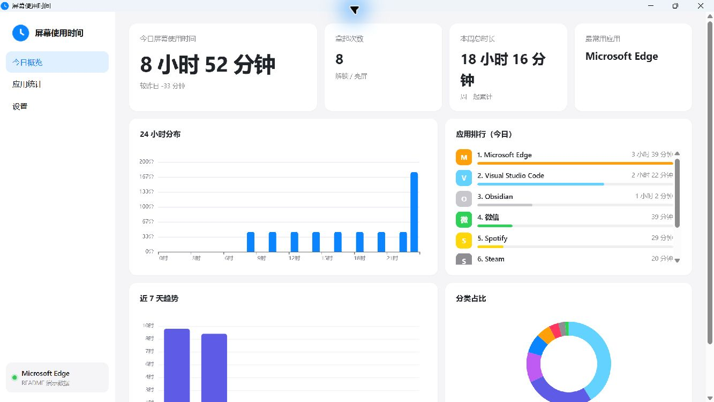
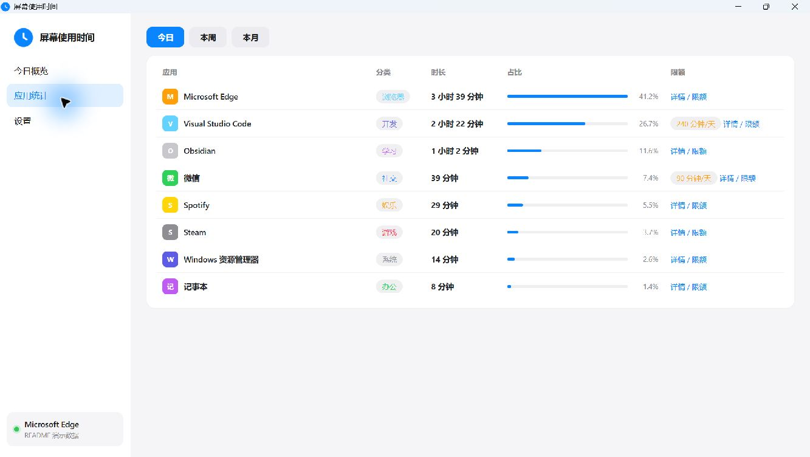
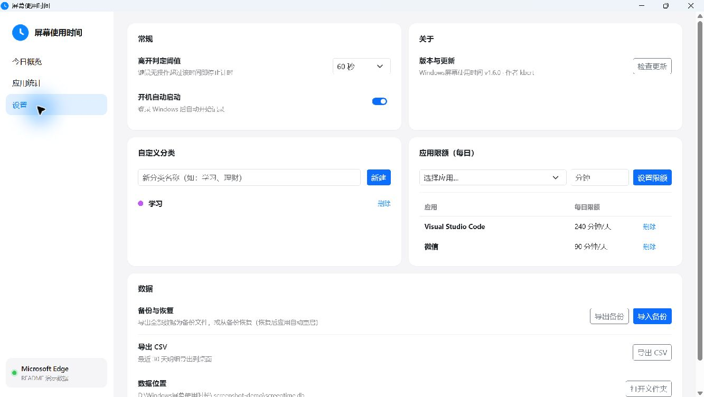
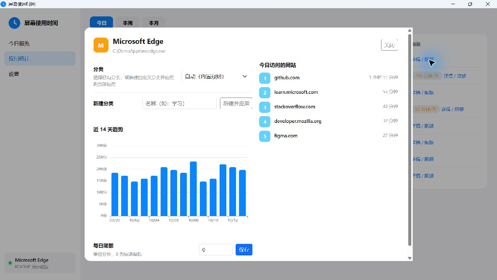

<p align="center">
  
</p>

# Windows屏幕使用时间

[](https://github.com/microkbcrt/Windows-ScreenTime/releases/latest)
[](https://github.com/microkbcrt/Windows-ScreenTime/releases/latest)
[](https://dotnet.microsoft.com/)

对标手机端「屏幕使用时间」的 Windows 桌面软件。按秒记录前台应用，按分钟聚合，并通过本地仪表盘展示屏幕时间、应用排行、分类占比、浏览器网站访问和使用趋势。

[下载最新版本](https://github.com/microkbcrt/Windows-ScreenTime/releases/latest) · [查看更新日志](https://github.com/microkbcrt/Windows-ScreenTime/releases) · [提交 Issue](https://github.com/microkbcrt/Windows-ScreenTime/issues)

## 界面预览

以下截图使用隔离生成的演示数据，不包含任何真实使用记录。









## 功能

- 秒级前台应用计时，只有在未锁屏、显示器点亮且键鼠未超过离开阈值时计时
- 今日、本周、本月总时长，拿起次数，24 小时分布和近 7 天趋势
- 应用排行、真实应用图标、分类占比和 14 天单应用趋势
- 浏览器网站级统计，支持 Chrome、Edge、Firefox、Brave 等
- 内置分类规则，支持手动修改分类和新建自定义分类
- 应用每日限额与到点提醒，不强制拦截应用
- 系统托盘常驻、开机自启、CSV 导出、完整数据备份与恢复
- 启动时检查 GitHub Release，可一键下载并原地升级

## 下载与安装

1. 打开 [Releases](https://github.com/microkbcrt/Windows-ScreenTime/releases/latest)。
2. 下载 `Windows-ScreenTime_Setup_x.y.z.exe`。
3. 双击安装。安装包为用户级安装，不需要管理员权限。

当前发布包为自包含 `win-x64` 版本，目标机无需另行安装 .NET。界面使用 Microsoft Edge WebView2；Windows 10/11 的常规安装通常已包含 WebView2 Runtime。

安装时可选择：

- 创建桌面快捷方式
- 登录 Windows 后自动启动并静默记录

## 数据与隐私

所有数据均保存在本机，不上传云服务，也不要求登录账号。

| 内容 | 位置 |
|---|---|
| SQLite 数据库 | `%LOCALAPPDATA%\ScreenTime\screentime.db` |
| 运行日志 | `%LOCALAPPDATA%\ScreenTime\log.txt` |
| 应用图标缓存 | `%LOCALAPPDATA%\ScreenTime\icons` |
| WebView2 缓存 | `%LOCALAPPDATA%\ScreenTime\WebView2` |

- 未锁屏、熄屏或超过离开阈值的时间不计入使用时长。
- 网站级统计通过 Windows UI Automation 读取浏览器窗口信息，仅保存站点名称和时长。
- 卸载程序时默认保留用户数据，避免历史统计丢失。
- 可在设置页导出完整备份、恢复备份，或导出最近 30 天 CSV。

## 计时规则

一段前台时间只有同时满足以下条件才会累计：

1. Windows 未锁定。
2. 显示器处于点亮状态。
3. 键鼠空闲时间未超过设置中的「离开判定阈值」。

默认离开阈值为 60 秒，可在设置页调整为 30 秒、1 分钟、2 分钟或 5 分钟。

## 从源码构建

### 环境要求

- Windows 10/11 x64
- [.NET 8 SDK](https://dotnet.microsoft.com/download/dotnet/8.0)
- [Inno Setup 6](https://jrsoftware.org/isinfo.php)（仅编译安装包时需要）

### 构建与发布

```powershell
# 构建解决方案
dotnet build ScreenTime.sln -c Release

# 生成自包含单文件版本
dotnet publish src/ScreenTime.App -c Release -r win-x64 --self-contained true `
  -p:PublishSingleFile=true `
  -p:IncludeNativeLibrariesForSelfExtract=true `
  -p:EnableCompressionInSingleFile=true `
  -o installer/publish

# 补拷前端静态资源；漏掉此步会导致 echarts 等文件缺失
Copy-Item src/ScreenTime.App/wwwroot/* installer/publish/wwwroot -Recurse -Force

# 编译安装包，产物位于 dist
& "$env:LOCALAPPDATA\Programs\Inno Setup 6\ISCC.exe" installer/setup.iss
```

安装包输出为 `dist\Windows-ScreenTime_Setup_<版本>.exe`。

### 验证工具

```powershell
# 打印今日统计
dotnet run --project src/ScreenTime.Cli -c Release -- summary

# 测试当前浏览器窗口的网站识别
dotnet run --project src/ScreenTime.Cli -c Release -- sitetest

# 测试检查更新、下载和安装流程
dotnet run --project src/ScreenTime.Cli -c Release -- updatetest
```

## 项目结构

| 目录 | 说明 |
|---|---|
| `src/ScreenTime.Core` | 前台监控、锁屏、熄屏、空闲、浏览器 UIA 和数据库 |
| `src/ScreenTime.App` | WPF 主程序、WebView2 仪表盘、托盘、提醒和设置 |
| `src/ScreenTime.Cli` | 控制台采集与诊断工具 |
| `installer` | Inno Setup 打包脚本和中文语言文件 |
| `docs/images` | README 使用的应用界面截图 |

## 常见问题

### 为什么有些时间没有被统计？

锁屏、熄屏以及键鼠无操作超过离开阈值的时间会被排除。可在设置页调整阈值。

### 为什么应用详情里没有网站列表？

网站级统计只适用于浏览器分类的应用。其他应用只统计应用本身的使用时长。

### 浏览器网站列表为空怎么办？

确认浏览器窗口处于前台并已打开页面；部分特殊页面、纯本地页面或浏览器限制 UI Automation 时可能无法识别站点。

### 如何迁移或保留数据？

在设置页导出完整备份，换机后导入即可。备份恢复成功后应用会自动重启。

## 版本

当前版本：**1.6.0**

完整变更见 [GitHub Releases](https://github.com/microkbcrt/Windows-ScreenTime/releases)。

## License

MIT
